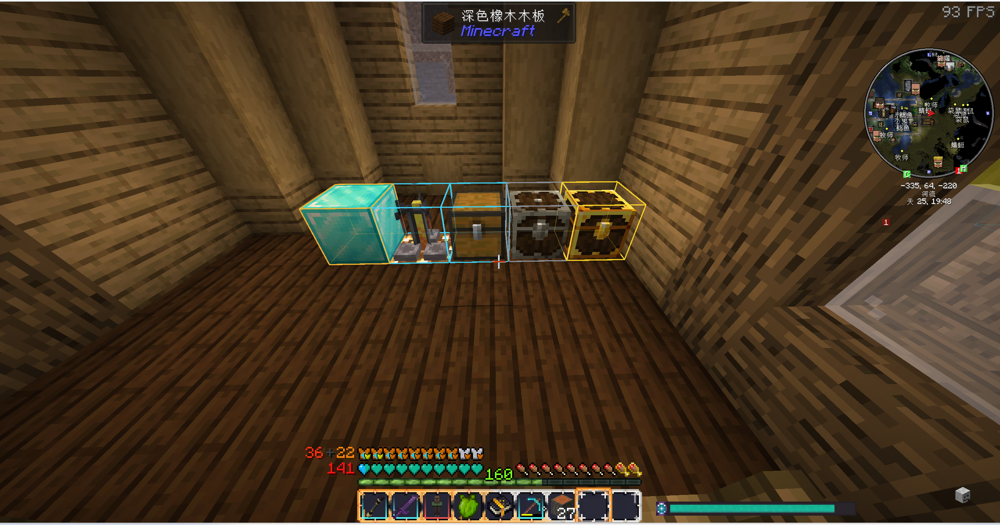
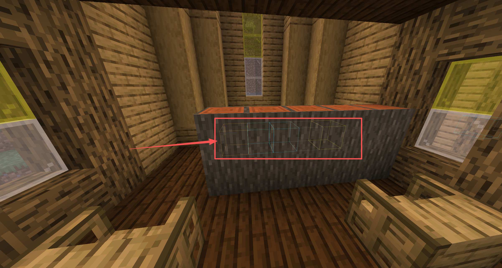

# Container Radar


穿墙高亮附近的容器 —— 按**能力**识别，而不是按方块 ID。

> A client-side Minecraft mod that highlights nearby containers through walls by
> detecting the Forge `IItemHandler` capability, so containers from **any** mod are
> recognized automatically — no per-mod compatibility code.



同一画面里的三种状态：普通容器（青色）、Lootr 已开启（灰色）、Lootr 未开启（金色）。
再加白名单里的自定义方块会显示橙色。



红框处是柜台后面的三个箱子（青色两个、金色一个）。没被遮挡的框较实，被挡住的会淡一些 ——
位置和距离都能判断，所以既有"透视"也有"遮挡感"。

**当前状态**：核心功能可用。容器识别、穿墙渲染、任意方块白名单、准星选取快捷键、
Lootr 状态着色均已完成；图形化配置界面与 JEI 拖拽仍在计划中（见 Roadmap）。

## 为什么还要再造一个轮子？

现有的容器透视类模组（Chest ESP、Chest Finder ESP 等）普遍采用**硬编码方块白名单**——
把 `minecraft:chest`、`minecraft:barrel` 之类的 ID 写死在代码里。这带来三个问题：

- 装了 **Lootr**，Lootr 的战利品箱认不出来
- 装了 **铁箱子 / 精妙存储 / Create 仓库**，同样认不出来
- 想支持一个新方块，只能等作者更新

Container Radar 换了一种判断方式：

```java
BlockEntity be = level.getBlockEntity(pos);
if (be != null && be.getCapability(ForgeCapabilities.ITEM_HANDLER).isPresent()) {
    // 这就是容器
}
```

只要一个方块实体对外声明了 Forge 的 `ITEM_HANDLER`（物品存储能力），它就自动被认定为容器。
**不管是哪个模组、什么方块，一行兼容代码都不需要。**

这是本项目唯一的核心思路，也是它存在的理由。

## Roadmap

| 功能 | 状态 |
| --- | --- |
| 基于 capability 的容器识别 | 已完成 |
| `/cr scan` 调试指令（打印坐标与方块 ID） | 已完成 |
| 穿墙线框渲染（双 pass：近处实色 / 墙后淡色） | 已完成 |
| 自定义方块白名单（任意方块可高亮） | 已完成 |
| Lootr「已开启 / 未开启」状态差异化着色 | 已完成 |
| 准星选取加入 / 移出白名单（快捷键） | 已完成 |
| 配置文件（半径 / 显示开关 / 渲染上限，热生效） | 已完成 |
| 图形化设置界面（开关 + 半径滑块 + 搜索 + 白名单管理，按 `O` 打开） | 已完成 |
| 从 JEI 拖拽添加方块 | 计划中 |

## 环境要求

- Minecraft **1.20.1**
- Forge **47.4.28**（依赖范围 `[47,)`）
- Java **17**

纯客户端模组，目标是不需要在服务端安装。注意 `/cr scan` 指令目前走服务端执行路径，
因此该调试功能仅在单人游戏或服务端也装了本模组时可用；正式的高亮功能会改为纯客户端。

## 从源码构建

```bash
# Windows
gradlew.bat build

# macOS / Linux
./gradlew build
```

产物：`build/libs/containerradar-<version>.jar`

## 使用

把 jar 放进 `.minecraft/mods/`，进入游戏（需开启作弊）。

### 高亮

装好即生效：附近 16 格内的目标会显示线框。没被遮挡的框较实，被墙挡住的会以淡色透出来 ——
这样你能同时判断"它在哪"和"它离我多远"。颜色区分四种含义：

| 颜色 | 含义 |
| --- | --- |
| 青色 | 普通容器（自己放的箱子、木桶、漏斗……） |
| 金色 | **Lootr 容器，你还没开过 —— 里面有属于你的战利品** |
| 灰色 | **Lootr 容器，你已经开过了 —— 不用再跑一趟** |
| 橙色 | 你在自定义白名单里加的方块 |

### Lootr 兼容是怎么做的

Lootr 的容器方块实体实现了公开接口 `noobanidus.mods.lootr.api.IHasOpeners`，
它只有一个方法 `Set<UUID> getOpeners()`，返回开过这个容器的所有玩家。

这份数据**在客户端也有值** —— 有人会怀疑"服务端状态客户端拿不到"，但 Lootr 自己的
`LootrChestBlockRenderer#getMaterial` 就是在客户端读 `getOpeners()` 来决定贴图是金色还是蓝色。
既然它能在纯客户端画出两种颜色，我们只是把同一份数据拿来给线框上色。

实现上**不引用任何 Lootr 的类型名**，全程用反射：

```java
if (!ModList.get().isLoaded("lootr")) return State.NOT_LOOTR;   // 没装就直接放弃
Method m = clazz.getMethod("getOpeners");
Set<?> openers = (Set<?>) m.invoke(be);
return openers.contains(myUuid) ? State.OPENED : State.UNOPENED;
```

原因是硬依赖会让**没装 Lootr 的玩家启动即崩溃**（`NoClassDefFoundError`）。
反射的结果按类缓存，连"这个类没有 getOpeners"也缓存 —— 抛异常的开销很高，
渲染路径上每帧抛一次会明显掉帧。

### 快捷键

| 默认按键 | 作用 |
| --- | --- |
| `J` | 开启 / 关闭全部高亮（总开关，关掉后连扫描都不做） |
| `K` | 把准星指向的方块加入白名单 |
| `L` | 把准星指向的方块移出白名单 |
| `O` | 打开设置界面 |

四个键都可以在「选项 → 控制 → 按键绑定 → 容器雷达」里改。属于游戏中生效（`IN_GAME`），
打开背包时按不会误触发。如果整合包里这些键已被占用，Minecraft 会显示成别的键
（例如小键盘）—— 进去点一下重新绑即可。

比敲指令方便得多——`minecraft:ancient_debris` 这种 ID 不用再手打了。

### 指令

```
/cr                 查看指令列表
/cr scan            按配置的半径扫描，打印找到的目标
/cr scan 64         临时指定半径（1 ~ 128），不改配置

/cr add <方块ID>     加入自定义白名单（可省略 minecraft: 前缀，支持 Tab 补全）
/cr add ancient_debris
/cr add create:zinc_ore
/cr remove <方块ID>  移出白名单
/cr search <关键词>  按 ID 或名称搜索方块（支持中文，如 /cr search 钻石）
/cr list            查看当前白名单

/cr radius 48       设置扫描半径（8 ~ 64），写入配置文件
/cr toggle          开启 / 关闭全部高亮（总开关）
/cr toggle containers   单独开关容器高亮
/cr toggle whitelist    单独开关白名单高亮
/cr reload          重新读取配置文件
```

白名单里的方块会显示**橙色**线框，和容器的青色区分开。

输出示例：

```
[ContainerRadar] 半径 32 内找到 7 个目标（容器 + 自定义方块），耗时 3 ms
  (112, 64, -34)  minecraft:chest        [容器]
  (113, 64, -34)  lootr:chest            [容器]
  (108, 40, -30)  minecraft:ancient_debris  [方块]
  ...
```

### 配置文件

设置存在 `.minecraft/config/containerradar-settings.json`：

```json
{
  "enabled": true,
  "radius": 32,
  "showContainers": true,
  "showWhitelist": true,
  "maxRendered": 400
}
```

| 字段 | 说明 |
| --- | --- |
| `enabled` | 总开关。`false` 时完全不扫描、不渲染，开销为零 |
| `radius` | 扫描半径（格），有效范围 8 ~ 64 |
| `showContainers` | 是否绘制容器 |
| `showWhitelist` | 是否绘制白名单方块 |
| `maxRendered` | 单帧最多绘制多少个框。超出的按距离丢弃最远的，防止"白名单加了草方块"这类情况把帧率拖死 |

手动改完文件后执行 `/cr reload` 即可生效，不必重启游戏。删掉某个字段或整份文件也能正常工作——
缺失的键会回到默认值，而不是被当成 0。

### 设置界面

按 `O` 打开。上面是总开关、两个分类开关和扫描半径滑块，下面左右两个列表：

- **左：搜索结果** —— 输入关键词实时筛选，点一下加入白名单（已加入的显示为灰色）
- **右：白名单** —— 点一下移除

搜索**同时匹配方块 ID 和本地化名称**，所以输 `钻石` 和 `diamond` 都能找到东西。
中文搜索依赖游戏语言：英文环境下名称是英文，按 ID 搜仍然有效。

索引在首次打开界面时构建（约 0.3 秒），之后每次搜索都是亚毫秒级。
没做拼音搜索 —— 那需要维护一张全量汉字的拼音表，不值得。

### 手动编辑白名单

白名单存在 `.minecraft/config/containerradar-blocks.txt`，一行一个方块 ID：

```
# ContainerRadar 自定义方块白名单
minecraft:ancient_debris
minecraft:spawner
create:zinc_ore
```

改完重启游戏生效。注意：用 `/cr add`、`/cr remove` 修改后，文件会被重写，手写的注释会丢失。

## 项目结构

```
src/main/java/com/scx/containerradar/
├── ContainerRadar.java            模组入口，注册事件与指令
├── command/
│   └── ScanCommand.java           /cr 指令树：参数解析 + 结果输出
├── compat/
│   └── LootrCompat.java           Lootr 状态识别（纯反射，不硬依赖）
├── config/
│   └── Settings.java              用户设置（总开关 / 半径 / 显示开关 / 渲染上限）
├── filter/
│   └── BlockFilter.java           自定义方块白名单 + 配置文件读写
├── gui/
│   └── SettingsScreen.java        设置界面（开关、滑块、搜索、白名单管理）
├── key/
│   └── KeyBindings.java           快捷键（J 开关 / K 加入 / L 移出 / O 设置）
├── render/
│   └── ContainerRenderer.java     穿墙线框渲染（双 pass）
├── scan/
│   └── ContainerScanner.java      目标扫描（按区块遍历，指令与渲染共用）
└── search/
    └── BlockIndex.java            方块索引（ID + 本地化名称，供搜索用）
```

几个关键的分层：

- **`scan` 只回答"哪里有目标"**，不碰渲染、不碰界面、不碰按键。指令和渲染器调用的是同一个方法
- **`config` / `filter` 各自管一个配置文件**，互不影响，玩家删掉其中一个也能正常启动
- **`compat` 隔离所有对第三方模组的依赖**，且全程用反射，没装 Lootr 的玩家不受任何影响
- **`render` 每帧只做绘制**：颜色、Lootr 状态这些较贵的判断都在每秒一次的扫描里算好并缓存

## 踩坑记录

开发过程中真实遇到过、并且值得记下来的问题：

- **`StringArgumentType.string()` 会在冒号处截断**。它的底层是 `StringReader.readString()`，
  实测输入 `minecraft:diamond_ore` 只读到 `minecraft`，剩下 `:diamond_ore` 变成"尾随数据"，
  报 `Expected whitespace to end one argument`。所以指令参数要想接收带命名空间的 ID，
  必须用原版的 `ResourceLocationArgument.id()`——它按 ID 的字符集解析，允许冒号，
  还会自动给不带前缀的输入补 `minecraft:`。这个坑只有在接 Tab 补全（补全给的是完整 ID）时才暴露。
- **`StringArgumentType.word()` 更严格**，连冒号都不允许，用它在指令里接方块 ID 一定失败。
- **`ForgeRegistries.BLOCKS.getValue(id)` 对不存在的 ID 返回 `Blocks.AIR` 而不是 `null`**。
  所以 `getValue(id) != null` 永远成立，无法用来校验 ID 合法性 —— 必须用 `containsKey(id)`。
  教训：想知道一个键在不在，不要"取出来再判空"。
- **`RenderStateShard.LineStateShard` 是 protected**，包外无法引用，因此线宽只能用默认的 1 像素。
  网上教程说需要 Access Transformer，但那只针对 5 参数版的 `RenderType.create`；
  7 参数版是 public 的，自己 `new` 各个 state shard 就能绕过去。
- **`StringArgumentType.word()` 不允许冒号**，用它接方块 ID 会让 `minecraft:chest` 直接解析失败。
  要用 `string()`。

## 许可

[MIT](LICENSE)
